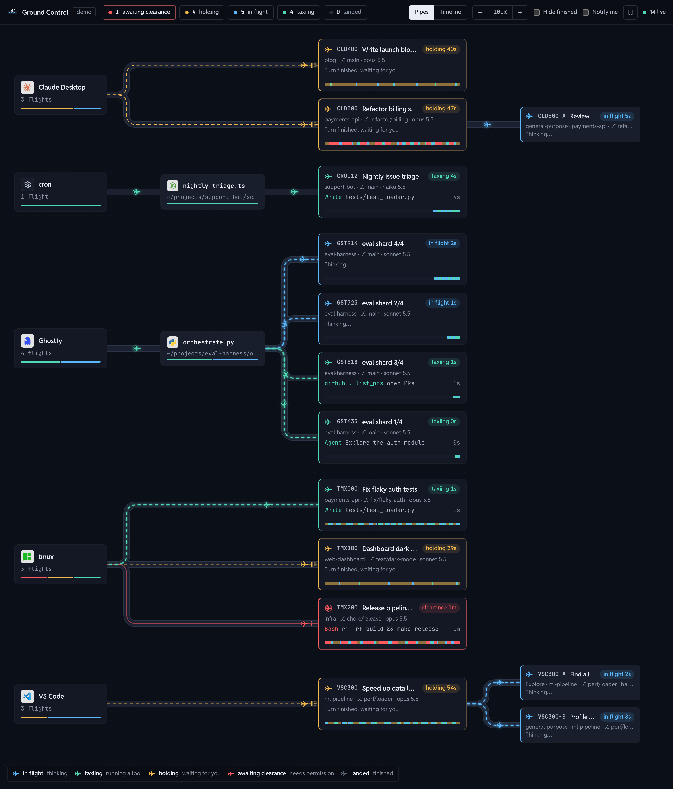
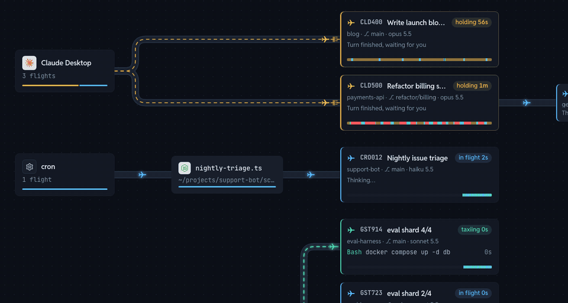
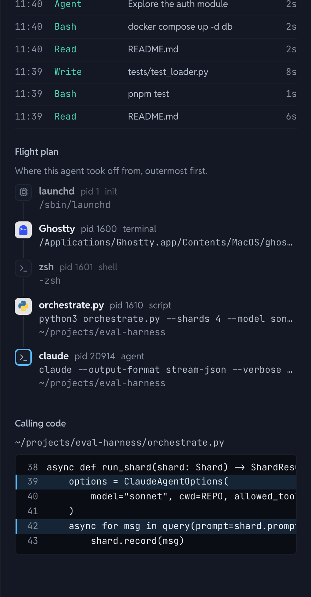
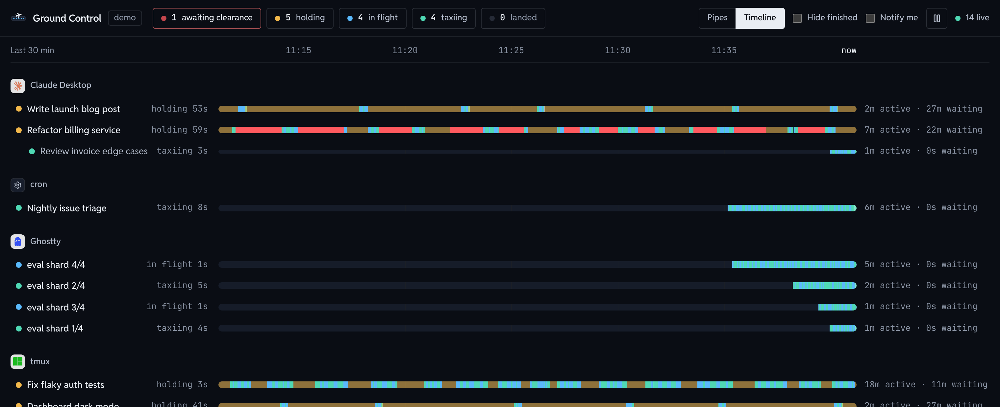

<h1 align="center">Ground Control</h1>

<p align="center"><b>Air traffic control for your Claude Code agents.</b><br>
Every running <code>claude</code> is a plane on a taxiway from the app or script that launched it.<br>
See at a glance who's working, who's waiting on you, and who's stuck on a permission prompt.</p>

<p align="center">
  <picture>
    <source media="(prefers-color-scheme: light)" srcset="docs/hero-light.png">
    
  </picture>
</p>

## Read the map

| You see                                                                   | It means                                             |
| ------------------------------------------------------------------------- | ---------------------------------------------------- |
|  moving                    | **In flight**: the agent is thinking                 |
|  moving faster               | **Taxiing**: it's running a tool (shown on the card) |
|  parked at the hold line     | **Holding**: turn finished, it's waiting for you     |
|  stopped at a red stop bar | **Awaiting clearance**: it needs your permission     |
|  dark taxiway                 | **Landed**: finished or exited                       |

Launchers on the left (Terminal, iTerm2, Ghostty, VS Code, Cursor, Claude Desktop, tmux, cron, your
own scripts, remote servers) feed agents on the right. Subagents branch off their parent. Every agent
gets a flight number like `VSC482`.

<p align="center"></p>

## Try it

Requires Node 22.4+ on macOS or Linux.

```bash
git clone https://github.com/djcopp/groundcontrol && cd groundcontrol
pnpm install && pnpm build
node dist/server/cli.js --demo   # a simulated fleet
node dist/server/cli.js          # your real agents, at http://127.0.0.1:4317
```

## Click any flight

<table>
  <tr>
    <td width="38%"></td>
    <td>
      <b>Flight plan</b>: the full launch chain, from the terminal or app down through shells, tmux and
      scripts to the agent.<br><br>
      <b>Calling code</b>: if a script launched it, the exact lines that call Claude.<br><br>
      Also: project, git branch, model, tokens, CPU and the flight log of recent tool calls.
    </td>
  </tr>
</table>

**Timeline** (press `t`): the last 30 minutes of every agent, so you can see who worked and who sat waiting.

<p align="center"></p>

## Watch your servers too

```bash
node dist/server/cli.js --remote devbox --remote me@10.0.0.5
```

Runs `groundcontrol --stream` on each host over plain SSH, using your own keys and `~/.ssh/config`.
No ports are opened anywhere, and the remote side exits when the session ends. A Slack bot that
shells out to `claude -p` on your server shows up with its script as the launcher. Claude in Slack
and other cloud sessions run on Anthropic's machines, so there's nothing local to watch.

<details>
<summary>Remote setup details</summary>

The remote needs Node 22.4+ and Ground Control on the `PATH` of a non-interactive shell.

```bash
node dist/server/cli.js --remote gpu-box --remote-cmd "bash -lc 'cd ~/groundcontrol && node dist/server/cli.js --stream'"
node dist/server/cli.js --remote prod-bastion --ssh "tsh ssh"
node dist/server/cli.js --remote devbox --no-local   # only the remote
```

- `BatchMode` is on, so a host that wants a password shows an error instead of hanging.
- The default remote command is deliberately not `npx -y groundcontrol`, which would run whatever
  is published under that name.
- A classic tunnel works too: run Ground Control on the server, then
  `ssh -L 4317:127.0.0.1:4317 devbox`.

</details>

## How it knows

<details>
<summary>Where every piece of data comes from</summary>

| What you see               | Source                                                                                               |
| -------------------------- | ---------------------------------------------------------------------------------------------------- |
| Which agents exist         | `ps`: processes whose executable is `claude` (native, desktop-bundled, or npm `cli.js`)              |
| Where it was launched from | the parent-process chain, classified into apps, terminals, IDEs, tmux, SSH and interpreters          |
| Calling code               | the launching script, read for lines mentioning `claude`, `anthropic` or the Agent SDK               |
| Directory and branch       | `lsof` (macOS) or `/proc/<pid>/cwd` (Linux), then `.git/HEAD`                                        |
| Busy or idle               | `~/.claude/sessions/<pid>.json`, written by Claude Code (the `.key` files are never opened)          |
| Thinking, tool, waiting    | the session transcript `~/.claude/projects/<dir>/<session>.jsonl`, tailed incrementally              |
| Awaiting clearance         | a pending tool call while idle, an Edit/Write pending over 6 s, or a Bash call with no child process |
| Subagents                  | `<session>/subagents/agent-*.jsonl` and `.meta.json`                                                 |

Headless agents (`claude -p`, SDK) are matched to the transcript created closest to their start.

</details>

<details>
<summary>All options</summary>

```
-p, --port <n>        Port (default 4317)
    --host <addr>     Bind address (default 127.0.0.1)
    --demo            Simulated agents
    --claude-dir <d>  Claude config dir (default $CLAUDE_CONFIG_DIR or ~/.claude)
    --interval <ms>   Sample rate (default 1000)
    --window <min>    Timeline length (default 30)
    --no-details      Hide tool arguments (commands, file names)
    --json            Print one snapshot and exit
    --no-open         Don't open a browser
    --remote <target> Watch an SSH host too (repeatable)
    --remote-cmd <c>  Remote command (default "groundcontrol --stream")
    --ssh <cmd>       SSH client (default "ssh")
    --no-local        Only remote hosts
    --stream          Remote end of --remote: JSON lines on stdout
```

Keyboard: `t` map/timeline, `+` `-` `0` zoom, `Esc` close. "Notify me" sends a desktop
notification when an agent starts waiting, and the tab title counts them, e.g. `(1! 3) Ground Control`.

</details>

## Privacy

Local only. It binds to `127.0.0.1`, rejects non-loopback `Host` headers (blocking DNS rebinding),
and makes no network calls; fonts and icons are bundled. `--no-details` hides commands and file
names.

## Development

```bash
pnpm dev        # API on :4317 + Vite UI on :5173
pnpm dev:demo   # same, simulated agents
pnpm test && pnpm typecheck && pnpm lint && pnpm build
```

`src/collector` reads processes, sessions and transcripts; `src/server.ts` serves HTTP and SSE;
`src/remote.ts` handles SSH hosts; `web/src` is the React UI (`layout.ts` turns a snapshot into the
map). Windows isn't supported yet; PRs welcome.

## Credits

App logos from [gilbarbara/logos](https://github.com/gilbarbara/logos) and
[Simple Icons](https://simpleicons.org) (CC0), glyphs from [Lucide](https://lucide.dev) (ISC); see
`web/public/icons/icons-credits.json`. Product names and logos are trademarks of their owners, used
only to name the app an agent was launched from. Type: Reddit Sans and JetBrains Mono (SIL OFL).
MIT licensed.
